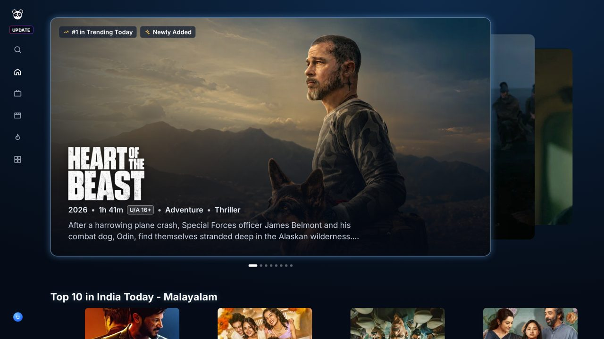
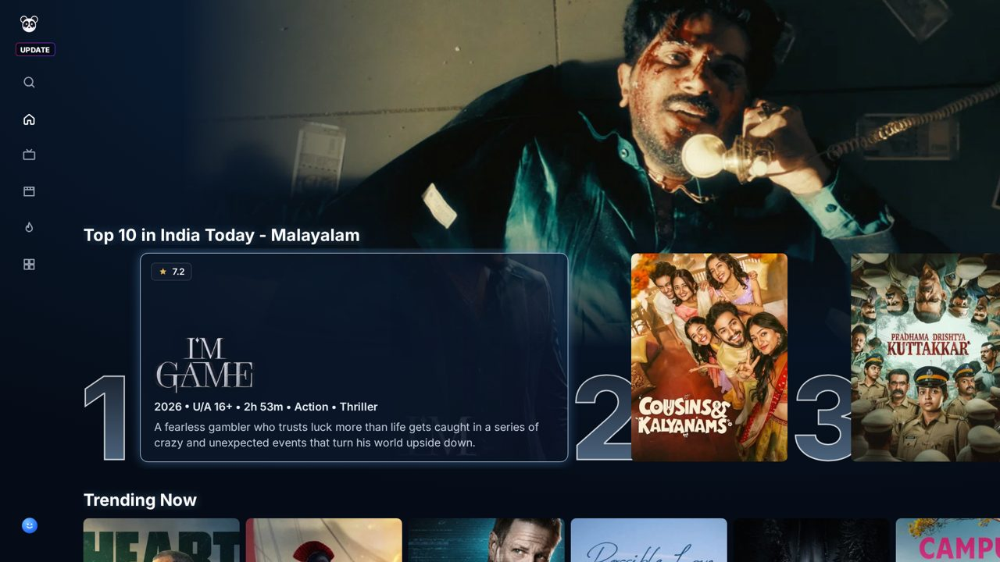
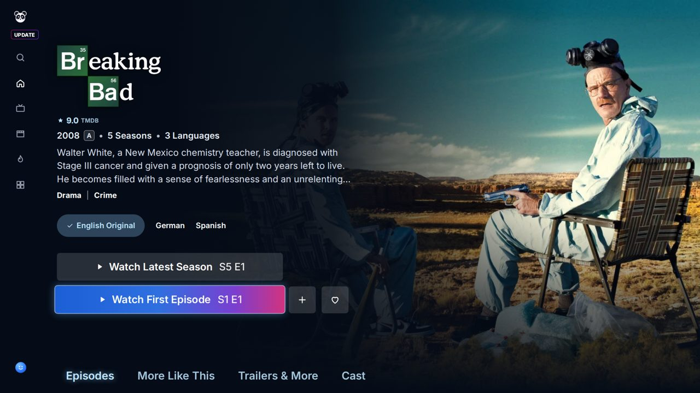
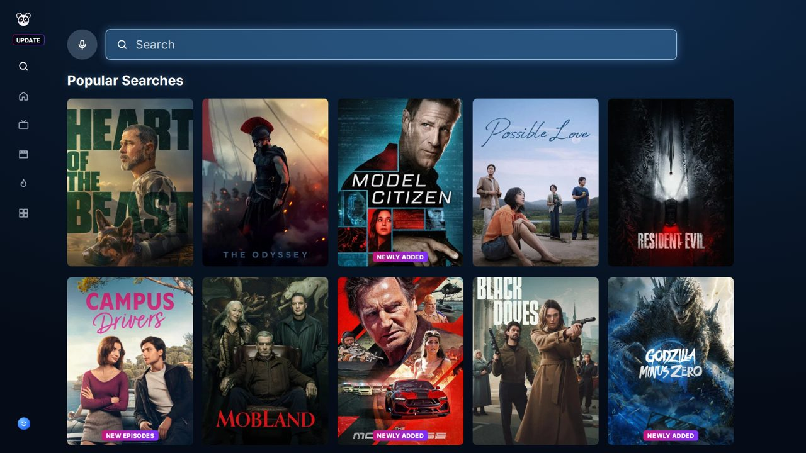
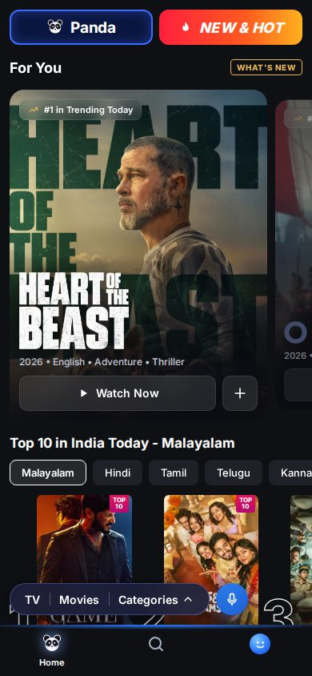
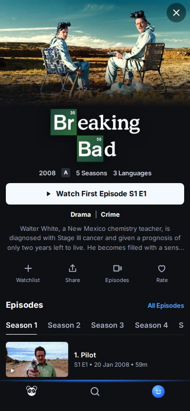
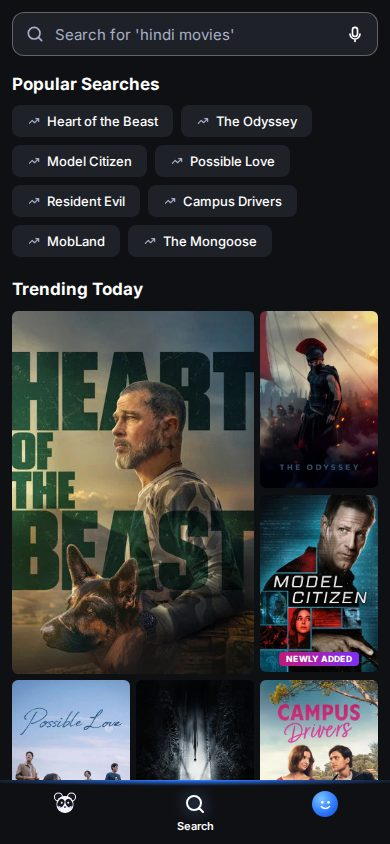
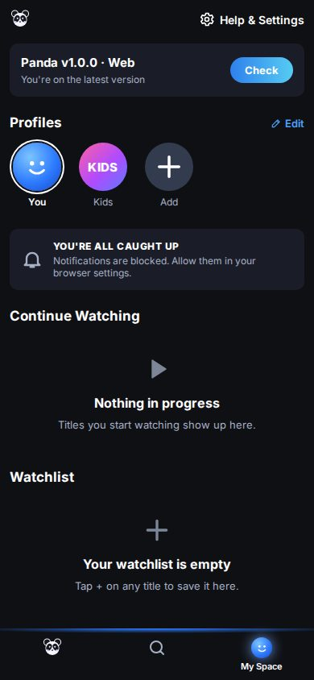

# Panda.fun

A streaming catalogue app for **Android TV, phones, tablets and the web**, built as a faithful replica of the Panda blueprint (TV + mobile). One React codebase renders a remote-driven 10-foot TV interface and a touch mobile interface; an Android wrapper ships both in a single signed APK with in-app updates from GitHub Releases.

- Live web app: deployed to Vercel production from `main` (project `mypanda`); the download landing page is at `/welcome`
- Backend: [titan717/movieapi](https://github.com/titan717/movieapi) — `https://apikinoma.vercel.app/api/v1/panda/*`
- Android releases: [GitHub Releases](https://github.com/titan717/Panda.fun/releases/latest)

## Screenshots

TV (1920 × 1080, D-pad)

| Home hero | Rows with focus expansion |
|---|---|
|  |  |
| **Details** | **Search** |
|  |  |

Mobile (390 × 844, touch)

| Home | Details | Search | My Space |
|---|---|---|---|
|  |  |  |  |

## Features

- **Pages:** splash, Who's watching (select, add, edit, delete, kids profiles), Home, Movies, TV Shows, New & Hot, Categories and genre browse, Search (recent and popular searches, voice input where supported, results, filters, empty states), Details (trailer, seasons and episodes, all-episodes page, cast, more like this, trailers & more), My List, Continue Watching, Player, Settings (playback, language, notifications, profiles, Check for Updates), About, Privacy, Terms.
- **Hero and trailers:** auto-advancing carousel; after focus rests on a title for 5 s (per profile) its trailer plays in a sandboxed youtube-nocookie frame. The frame stays hidden and silent for 2 s after it starts playing so YouTube's title and logo overlay never show, then fades in over 600 ms and the sound ramps in; it loops without hiding and is paused and removed when focus leaves. Rules and tests: [docs/TRAILERS.md](docs/TRAILERS.md).
- **Sources:** CineSrc, Vidy, Vidy Anime and VidLink, ordered by measured ad tier first and community ranking second; a weekly workflow re-measures them ([docs/SOURCES.md](docs/SOURCES.md)).
- **TV:** spatial navigation (`@bbc/tv-lrud-spatial`), visible focus everywhere, rail navigation, row focus expansion, Back on Backspace / Escape / Android Back / webOS 461 / Tizen 10009, media keys, overscan-safe margins, scaling for 720p / 1080p / 4K.
- **Mobile:** bottom navigation, swipeable carousels, sheets, safe-area insets, landscape layouts.
- **Design polish (v1.2.5 to v1.3.1):** shared type, spacing and Top 10 numeral tokens (`src/styles/tokens.css`), one card language for hover, keyboard focus and touch press, and TV rows that always scroll the focused card inside the overscan-safe margin. Each release is listed in [docs/CHANGELOG.md](docs/CHANGELOG.md); the current version is 1.3.1. On computers, rows get mouse arrows, the wheel steps through rows like the remote and the player has keyboard shortcuts (press ? while playing) (v1.2.8). v1.2.9 adds Who's watching on every start, new launch intros, CineSrc server memory and a new rating; v1.3.0 adds a non-skippable launch intro with a synthesised score and a deeper Who's watching screen; v1.3.1 gives TVs a retro stop-motion paper-cutout launch intro (see the changelog).
- **Player:** CineSrc, Vidy and VidLink behind one source registry with a source switcher, automatic fallback, remembered source and volume, resume from the last position, previous / next episode and a 10-second next-episode countdown. A first-frames screen with a buffering percentage, recap / intro / credits chapters on the seek bar, picture fit, lock controls on phones, volume steps and mute memory (v1.2.6); a subtitles panel with tracks, dual subtitles, SDH, live style preview, 0.1 s timing and per-title memory, plus the CC key (v1.2.7). What each source allows is in [docs/PLAYER.md](docs/PLAYER.md); see also [docs/PLAYER_COMPARISON.md](docs/PLAYER_COMPARISON.md).
- **Data:** SWR caching with retry, skeleton states that match final layout, offline and error states with retry, error boundaries.
- **Security:** strict CSP without inline code, SRI, HSTS, a keyed Android bridge, pinned CI with CodeQL, gitleaks, Dependabot and an SBOM per release ([docs/SECURITY.md](docs/SECURITY.md), [SECURITY.md](SECURITY.md)).
- **Privacy:** no analytics or tracking, no client secrets; profiles, My List and progress live in `localStorage`.
- **Accessibility:** semantic buttons and landmarks, labels on icon buttons, focus rings, `prefers-reduced-motion` respected.

## Architecture

```
                ┌──────────────────────── Panda.fun (this repo) ───────────────────────┐
                │  React 19 + Vite + TypeScript (strict)                                │
 Browser / TV ─▶│  lib/device → TV layout (tv/*)  or  mobile layout (mobile/*)          │
 Android WebView│  lib/api (SWR) ─────────────────────────────┐                        │
                │  lib/store (localStorage) · lib/focus · lib/keys · lib/player         │
                └──────────────┬───────────────────────────────┼──────────────────────────┘
                               │ iframe embeds                 │ HTTPS JSON
                     CineSrc / Vidy              titan717/movieapi (/api/v1/panda/*) ── TMDB
```

The Android app (`android/`) is a thin Kotlin WebView shell: it serves the bundled build through `WebViewAssetLoader` (`https://appassets.androidplatform.net/assets/web/`), exposes a small `KinomaNative` bridge (version, TV detection, update check / download / install, exit) and forwards the remote Back key to the web app.

## Backend

All catalogue data comes from [titan717/movieapi](https://github.com/titan717/movieapi):

| Endpoint | Used by |
|---|---|
| `GET /panda/page/{home\|movies\|tv\|kids\|new}` | Home, Movies, TV Shows, Kids profile, New & Hot |
| `GET /panda/title/{movie\|tv}/{id}` | Details (cast, trailers, similar, seasons) |
| `GET /panda/title/tv/{id}/season/{n}` | Episodes |
| `GET /panda/search?q=` | Search |
| `GET /panda/discover/{type}` · `/panda/genres` · `/panda/categories` | Categories and browse |
| `GET /panda/trending` · `/panda/top10/{lang}` | Rows, Top 10 |
| `GET /panda/play/{type}/{id}?s=&e=&t=` | Player sources |

## Setup

Requirements: Node.js 20+.

```bash
npm ci
npm run dev          # http://localhost:5173 (append ?layout=tv to force the TV layout)
```

### Environment variables

Copy `.env.example` to `.env.local` if you need to override the defaults. Nothing secret is used in the client.

| Variable | Default | Purpose |
|---|---|---|
| `VITE_API_BASE` | `https://apikinoma.vercel.app/api/v1` | movieapi base URL (Vercel deployments or localhost only) |
| `VITE_RELEASES_REPO` | `titan717/Panda.fun` | Repository whose GitHub Releases provide app updates |

### Scripts

| Command | What it does |
|---|---|
| `npm run typecheck` | `tsc -b` (strict) |
| `npm run lint` | ESLint, zero warnings allowed |
| `npm test` | Vitest unit tests (`src/test`) |
| `npm run build` | Web production build to `dist/` |
| `npm run build:android` | Build with relative asset paths and hash routing for the Android WebView |
| `npm run e2e` | Playwright smoke tests on TV (1920 × 1080, 1280 × 720), phone (390 × 844, 360 × 640) and tablet (820 × 1180) viewports |
| `node scripts/qa-shots.mjs <tv\|mobile> <w> <h> <route\|Key,Key> …` | Screenshot helper for visual QA (needs `npm run preview`) |

## Android APK

The signed release APK is built only in GitHub Actions — the keystore never touches the repository.

1. Repository secrets: `KINOMA_KEYSTORE_BASE64`, `KINOMA_KEYSTORE_PASSWORD`, `KINOMA_KEY_ALIAS`, `KINOMA_KEY_PASSWORD`.
2. Bump `version` in `package.json` on `main` (the web build reports this version), then run **Actions → Build and Publish Panda.fun Android TV Stable Release** (optionally enter `version_name`, e.g. `1.0.1`; otherwise the patch version is bumped).
3. The workflow type-checks, lints, tests, runs `npm run build:android`, copies `dist/` into `android/app/src/main/assets/web/`, builds `assembleRelease`, verifies the signature with `apksigner`, and publishes a GitHub Release `v<version>` with `Panda.fun-Android-TV.apk` and its `.sha256`.

One APK installs on phones, tablets and Android TV (leanback launcher entry and TV banner included).

## Update mechanism

- **Android:** Settings → Check for Updates calls the bridge, which reads `GET https://api.github.com/repos/titan717/Panda.fun/releases/latest`, compares the tag with the installed `versionName` (semantic version), and shows the release notes. Download runs through `DownloadManager` with progress shown in the app, the file is verified against the attached SHA-256, and Android's package installer is launched (the app asks for "install unknown apps" permission when needed). Up-to-date, offline and error states are shown with retry. A silent check also runs on launch.
- **Web:** the same screen shows the installed web version, the latest release and its notes, with a download link for the APK. Responses are cached for 15 minutes to stay inside GitHub's anonymous rate limit.

## Deployment

- **Web:** Vercel's Git integration builds every push to `main` as a production deployment (`vercel.json`: Vite framework, SPA rewrites, security headers and a strict Content-Security-Policy limited to movieapi, TMDB images, YouTube, GitHub API and the player hosts).
- **Backend:** movieapi auto-deploys to Vercel (`apikinoma.vercel.app`) from its `main` branch.
- **CI:** `.github/workflows/ci.yml` runs typecheck, lint, unit tests, web and Android builds and the Playwright smoke suite on every push and pull request.

## Folder structure

```
android/                Kotlin WebView shell (MainActivity, UpdateChecker, PlayerActivity), Gradle build
docs/                   BLUEPRINT_SPEC, AUDIT, PLAN, DECISIONS, ASSETS, PLAYER_COMPARISON, FINAL_REPORT, screenshots/
e2e/                    Playwright smoke tests
public/                 Icons, PWA manifest, TV banner
scripts/qa-shots.mjs    Screenshot helper
src/
  lib/                  api, store, device, keys, focus, player, updates, hooks, formatting
  components/           Shared UI (icons, sheets, trailer, overlays, skeletons, toasts)
  tv/                   TV shell, home, details, search, categories, My Space
  mobile/               Mobile shell, home, details, search, categories, My Space
  pages/                Player, profiles, lists, settings, updates, about/legal
  styles/               tokens.css, base.css, tv.css, mobile.css
.github/workflows/      ci.yml, build-apk.yml
```

## Credits

Catalogue data and images from [TMDB](https://www.themoviedb.org/); this product uses the TMDB API but is not endorsed or certified by TMDB. Asset licences are listed in [docs/ASSETS.md](docs/ASSETS.md).
