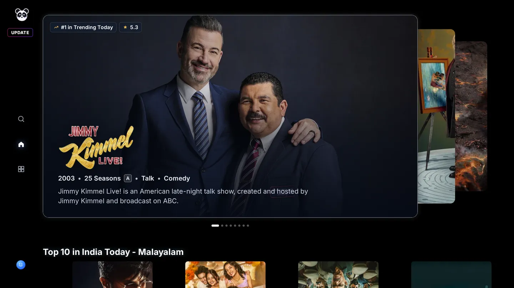
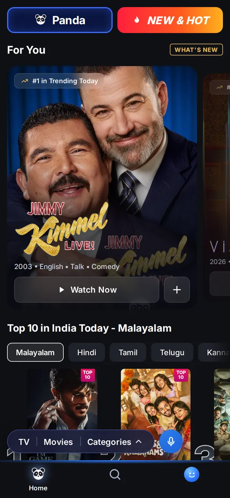
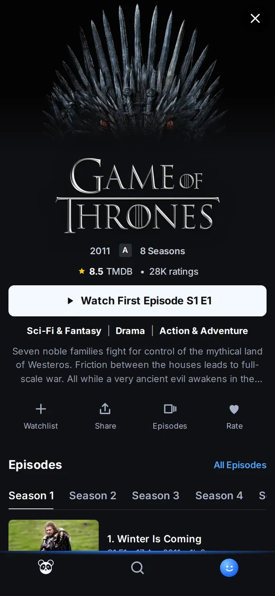
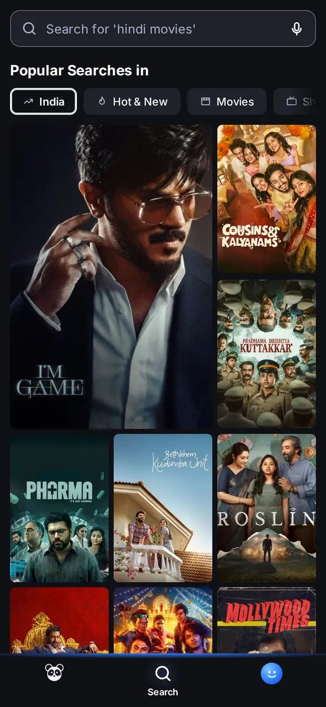

<!--
  Panda.fun — the same Panda, thoughtfully designed for every screen.
-->

<div align="center">
  
  <h1>Panda.fun</h1>
  <p><strong>More cinema. Less getting in the way.</strong></p>
  <p>A streaming experience for Android TV, phones, tablets and the web.</p>

  <p>
    <a href="https://pandatv2.vercel.app/"><strong>Open web app ↗</strong></a>
    &nbsp;·&nbsp;
    <a href="https://github.com/titan717/Panda.fun/releases/download/v1.3.1/Panda.fun-Android-TV.apk"><strong>Download Android APK ↓</strong></a>
    &nbsp;·&nbsp;
    <a href="https://github.com/titan717/Panda.fun/releases/tag/v1.3.1">Release notes</a>
  </p>
  <p><sub>Latest stable · v1.3.1 · One APK for phones, tablets and Android TV</sub></p>
</div>

---

## Made for the screen in front of you

Panda.fun brings a familiar catalogue experience to the living room and the phone. On TV, everything is built around the remote. On mobile, it is made for touch. On the web, open it straight in your browser.

<div align="center">
  
  <br />
  <sub>THE LIVING ROOM · ANDROID TV</sub>
  <br /><br />
  
  &nbsp;&nbsp;
  
  &nbsp;&nbsp;
  
  <br />
  <sub>ON THE GO · MOBILE</sub>
</div>

## The details matter

| | |
|---|---|
| **A real TV experience** | D-pad navigation, visible focus, remote-friendly layouts and overscan-safe spacing. |
| **Made for touch** | Bottom navigation, swipeable rows, sheets and phone-friendly layouts. |
| **Your own space** | Profiles, kids profiles, watchlist and continue-watching progress. |
| **A considered player** | Resume playback, episode navigation, subtitles and helpful playback controls. |
| **Discover naturally** | Home recommendations, categories, search, trailers and title details. |
| **No noisy tracking** | No analytics or tracking. Profiles, lists and progress are stored on your device. |

## Get Panda.fun

<div align="center">
  <h3>Android · v1.3.1</h3>
  <p>One signed APK for Android phones, tablets and Android TV.</p>
  <p>
    <a href="https://github.com/titan717/Panda.fun/releases/download/v1.3.1/Panda.fun-Android-TV.apk"><strong>Download Panda.fun v1.3.1</strong></a>
    &nbsp;·&nbsp;
    <a href="https://github.com/titan717/Panda.fun/releases/download/v1.3.1/Panda.fun-Android-TV.apk.sha256">SHA-256 checksum</a>
    &nbsp;·&nbsp;
    <a href="https://github.com/titan717/Panda.fun/releases/latest">All releases</a>
  </p>
</div>

**What's new in v1.3.1**

- A new retro paper-cutout stop-motion intro for Android TV.
- A matching original score, timed to the animation.
- Reduced-motion and Lite-mode alternatives.

See the full [v1.3.1 release notes](https://github.com/titan717/Panda.fun/releases/tag/v1.3.1) or the [complete changelog](docs/CHANGELOG.md).

### The web app

Open Panda.fun in your browser—no APK required.

**[Launch Panda.fun on the web ↗](https://pandatv2.vercel.app/)**

The web build is deployed to Vercel from `main`. The optional download and install guide is available at [the web welcome page](https://pandatv2.vercel.app/welcome).

## Built for more than one device

| Platform | Experience |
|---|---|
| **Android TV** | Remote-first interface with D-pad navigation |
| **Android phones & tablets** | Touch-first interface in the same APK |
| **Web** | Browser experience for desktop and mobile |

The TV player uses CineSrc. The phone and web experiences retain their own layouts and controls.

## For developers

Panda.fun is built with React, TypeScript and Vite. The Android app is a lightweight Kotlin WebView shell around the shared web application.

### Run locally

**Requirements:** Node.js 20+

```bash
git clone https://github.com/titan717/Panda.fun.git
cd Panda.fun
npm ci
npm run dev
```

Open [http://localhost:5173](http://localhost:5173). Append `?layout=tv` to force the TV layout.

### Useful commands

| Command | Description |
|---|---|
| `npm run dev` | Start the development server |
| `npm run build` | Build the web app |
| `npm run build:android` | Build with Android WebView asset paths |
| `npm run typecheck` | Run TypeScript checks |
| `npm run lint` | Run ESLint |
| `npm test` | Run unit tests |
| `npm run e2e` | Run Playwright smoke tests |

### Configuration

Copy `.env.example` to `.env.local` to override defaults.

| Variable | Default | Purpose |
|---|---|---|
| `VITE_API_BASE` | `https://apikinoma.vercel.app/api/v1` | Panda catalogue API |
| `VITE_RELEASES_REPO` | `titan717/Panda.fun` | GitHub repository used for Android updates |

### Project map

```text
android/                 Kotlin Android / Android TV wrapper
docs/                    Specifications, decisions, guides and screenshots
e2e/                     Playwright end-to-end tests
public/                  App icons, PWA assets and TV banner
src/
  lib/                   API, device detection, storage, focus and player
  components/            Shared interface components
  tv/                    Android TV interface
  mobile/                 Phone and tablet interface
  pages/                 Player, profiles, settings and legal pages
  styles/                Shared design tokens and platform styles
.github/workflows/       CI and signed Android release builds
```

## Project notes

- [Changelog](docs/CHANGELOG.md)
- [Player notes](docs/PLAYER.md)
- [Security](docs/SECURITY.md)
- [Asset credits and licences](docs/ASSETS.md)
- [Backend API](https://github.com/titan717/movieapi)

Catalogue metadata and artwork are provided through TMDB. Panda.fun is not endorsed or certified by TMDB.

---

<div align="center">
  
  <p><sub>Made with care by <a href="https://github.com/titan717">titan717</a>.</sub></p>
</div>
